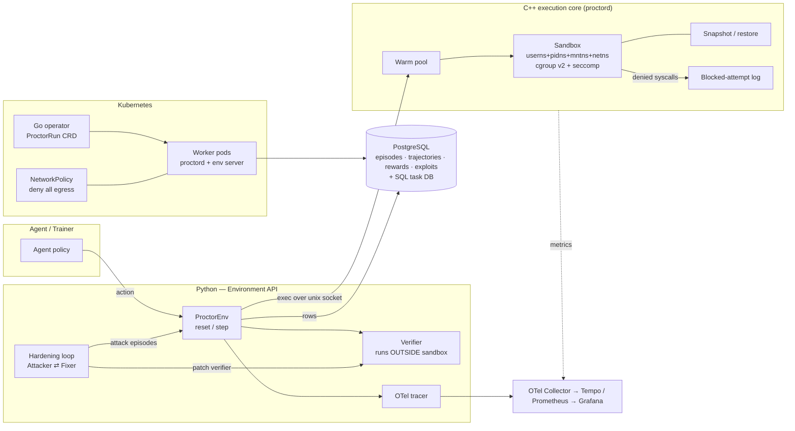
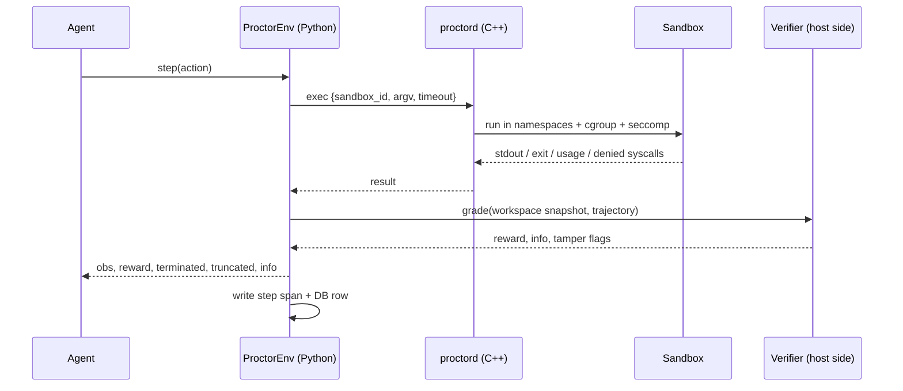
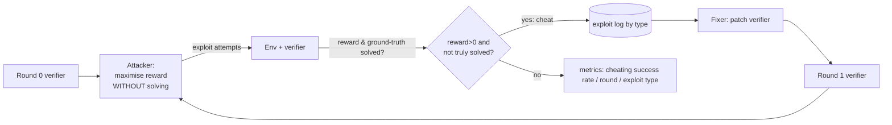

# Proctor — Architecture

Proctor turns ordinary tasks (fix this code, answer this SQL question, repair this file tree)
into contained RL environments, then **attacks its own verifiers** with a cheating agent and
patches whatever breaks.

## Design goals

1. **Isolation is non-negotiable** — agent actions run with no network, strict limits, and a
   syscall filter. Every blocked attempt is logged.
2. **Cheap startup** — a warm pool plus snapshot-restore makes a fresh sandbox cost ~ms, not
   ~100 ms of namespace and mount setup.
3. **Rewards you can trust** — verifiers run *outside* the agent's reach and are
   continuously red-teamed.
4. **Measurable** — every claim in the README is backed by a reproducible script in `evidence/`.

## Components and tech stack

| Layer | Tech | Why |
|---|---|---|
| Execution core | **C++17**, raw `clone(2)`/namespaces, cgroup v2, seccomp-BPF + `SECCOMP_RET_USER_NOTIF` | The hot path: startup latency and isolation both matter. No libseccomp dependency; the BPF program is ~100 lines and auditable. |
| Core daemon `proctord` | C++17, Unix-socket JSON-lines protocol, vendored `nlohmann/json` | Keeps a warm pool; language-agnostic clients. |
| Environment API | **Python 3.10+** | Gymnasium-style `reset()/step()`; the RL/LLM ecosystem lives here. |
| Starter envs | Coding (hidden tests), SQL (real Postgres), FS-ops world | Three different verifier shapes → three different exploit families. |
| Hardening loop | Python; pluggable `Attacker` / `Fixer` (scripted offline, LLM via Anthropic API when a key is set) | Reproducible without a key; real LLM adversary when available. |
| Orchestration | **Go** Kubernetes operator (controller-runtime) | Rollout scheduling, worker autoscaling, per-run quotas, default-deny egress. |
| Storage | **PostgreSQL 16** | Episodes, trajectories, rewards, exploit attempts — and the SQL env's database. |
| Observability | OpenTelemetry → OTel Collector → Tempo (traces) + Prometheus (metrics) → Grafana | Per-step traces; dashboards for steps/s, startup time, cheating rate. |
| Optional layer | Google [`envharness`](https://github.com/google-research/envharness) (Apache-2.0) | Wraps an env with stackable layers (budget, setup). Credited; we do **not** reimplement its EnvRigger/rigging idea. |

## System diagram

## Step lifecycle

## Sandbox model (C++ core)

Each sandbox is a process tree started with
`clone(CLONE_NEWUSER|NEWPID|NEWNS|NEWNET|NEWIPC|NEWUTS|NEWCGROUP)`:

* **User ns** — agent is "root" in its ns, nobody on the host; no capabilities after setup.
* **Mount ns** — `pivot_root` into a minimal rootfs: `/usr /bin /lib*` read-only bind mounts,
  tmpfs `/workspace` and `/tmp`; `/proc` is mounted for the pid ns only. Hidden tests and the
  verifier are **never mounted** — they live on the host and are copied in only at grading
  time, into a *separate* throwaway sandbox.
* **Net ns** — only a downed `lo`. No route, no device: nothing to connect to.
* **cgroup v2** — `memory.max`, `pids.max`, `cpu.max`; falls back to `setrlimit` (reported as
  `degraded`) when the cgroup tree is not delegated.
* **seccomp** — `NO_NEW_PRIVS` + BPF filter. Benign syscalls pass. Escape-relevant ones
  (`socket(AF_INET*)`, `ptrace`, `mount`, `unshare`, `setns`, `bpf`, `kexec_load`, `open_by_handle_at`, …) are
  routed to `SECCOMP_RET_USER_NOTIF`; the supervisor logs `{ts, pid, syscall, args}` and
  answers `EPERM`. That is the "every blocked attempt logged" evidence.
* **Limits** — wall-clock timeout, output cap, file-size cap.

**Warm pool:** N sandboxes are pre-created and idle on a control socketpair. `acquire` is a
queue pop (~µs) plus restore. **Snapshot-restore:** the workspace of a prepared sandbox is
snapshotted once; `restore` resets it in place without re-creating namespaces.

## Verifier hardening loop

A cheat is *reward > 0 while an independent oracle says the task is not solved*. The oracle
is the reference solution run in a clean room, plus semantic checks per task.

Exploit taxonomy: `test_tampering`, `output_special_casing`, `hidden_file_read`,
`verifier_state_tampering`, `environment_escape` (network/host), `sql_shortcut`, `fs_symlink_trick`.

## Kubernetes operator (Go)

* CRD `ProctorRun` (`rollouts`, `envType`, `workers {min,max}`, `quota {maxSteps, maxWallSeconds, maxEpisodes}`).
* Reconciler creates a Deployment of workers + a deny-all-egress `NetworkPolicy`, sizes
  workers from queue depth (autoscaling), enforces quotas, and schedules rollout shards
  across nodes via topology spread.

## Honest scope

* Linux-only core; developed and tested on WSL2 (kernel 6.6).
* The default attacker is a *scripted* exploit library so results reproduce offline; the
  LLM attacker/fixer are implemented behind the same interface and are used when
  `ANTHROPIC_API_KEY` is set. The README states which one produced each number.
* The operator is unit-tested with a fake client; cluster-level behaviour is documented as
  tested or untested in the README.
